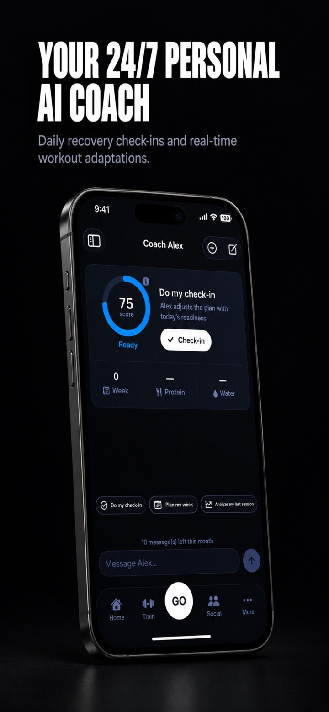
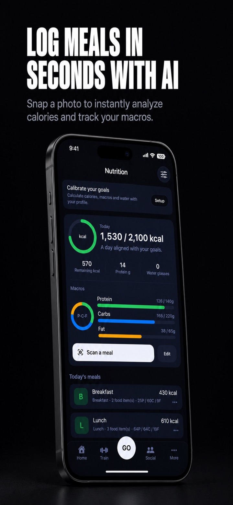
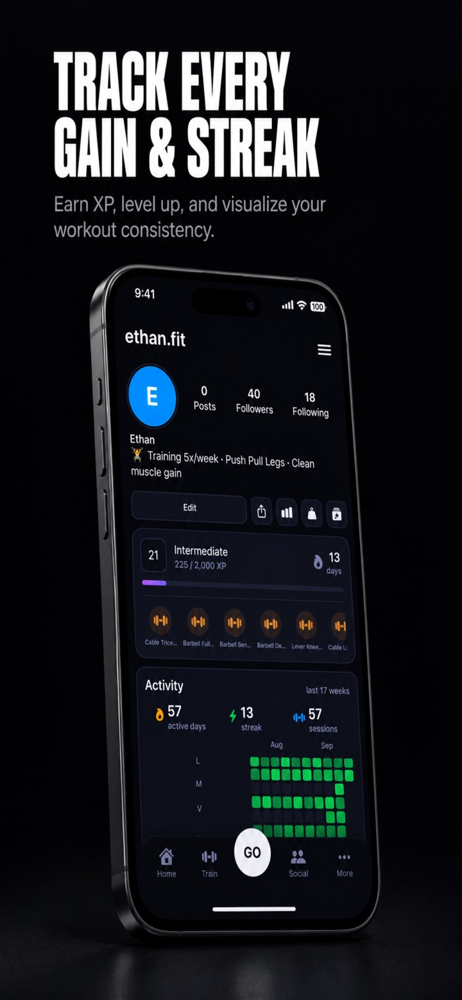

<picture>
  <source media="(prefers-color-scheme: dark)" srcset="assets/profile-dark.svg">
  <source media="(prefers-color-scheme: light)" srcset="assets/profile-light.svg">
  
</picture>

 
 

**IT Engineering student at ÉTS, Montréal.**

I build applications from the interface to the backend, with an interest in 
mobile development, cloud architecture, and practical AI integration.

Currently building **[Trayva](https://apps.apple.com/ca/app/trayva-ai-fitness-coach/id6768809797)**, my strength-training app available on the App Store.

 

## Featured project

### Trayva · AI Fitness Coach

A strength-training companion that brings workout tracking, AI coaching, and nutrition into one iOS app. Built end to end, from the SwiftUI interface to the cloud backend.

  
  
  

  <strong>SwiftUI</strong> &nbsp;·&nbsp; <strong>AI integration</strong> &nbsp;·&nbsp; <strong>Cloud backend</strong>

  

 

## What I work with

My toolkit spans mobile apps, web development, and the services behind them.

| Area | Technologies |
| :--- | :--- |
| **Mobile** | Swift · SwiftUI · iOS |
| **Web** | TypeScript · JavaScript · React · HTML · CSS |
| **Backend & data** | Java · Spring · C# · Python · PostgreSQL · MongoDB · SQLite |
| **Cloud & tools** | Supabase · AWS · Docker · Git · Linux |

Currently exploring AI integration in applications and cloud architecture.

 

## Let's connect

Happy to talk about IT engineering, mobile apps, backend systems, or building a product from scratch.

[LinkedIn](https://www.linkedin.com/in/yassine-el-jal-6718b42b6/) &nbsp;·&nbsp; [yassineeljal0@gmail.com](mailto:yassineeljal0@gmail.com)

 

  
A little contribution-graph fun

   
  <picture>
    <source media="(prefers-color-scheme: dark)" srcset="https://raw.githubusercontent.com/yassineeljal/yassineeljal/output/github-snake-dark.svg">
    <source media="(prefers-color-scheme: light)" srcset="https://raw.githubusercontent.com/yassineeljal/yassineeljal/output/github-snake.svg">
    
  </picture>

