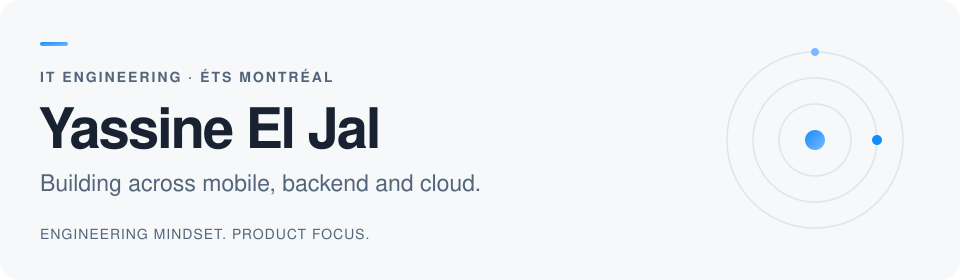

<picture>
  <source media="(prefers-color-scheme: dark)" srcset="assets/profile-dark.svg">
  <source media="(prefers-color-scheme: light)" srcset="assets/profile-light.svg">
  
</picture>

 
 

**IT Engineering student at ÉTS · Montréal, Canada**

Exploring how things work. Learning by building them.

&nbsp;

 
 

[About](#about) &nbsp; / &nbsp; [Toolbox](#toolbox) &nbsp; / &nbsp; [Activity](#activity)

 

## About

Hey, I'm Yassine 👋 An IT engineering student who enjoys connecting the pieces, from an interface to the services running behind it.

- 🎓 Studying **IT Engineering at ÉTS**, Montréal.
- 🛠️ Building across **mobile, web, backend, and cloud**.
- 🌱 Exploring **AI integration** and **cloud architecture**.
- 📱 Creator of **[Trayva](https://apps.apple.com/ca/app/trayva-ai-fitness-coach/id6768809797)**, a strength-training app on the App Store.

<strong>A little more about what I build ↗</strong>

I like working on a product from end to end: shaping the interface, building the backend, and connecting everything together.

Trayva is one example: an iOS strength-training app with workout tracking and an AI coach, built with SwiftUI and a cloud backend.

I'm always happy to talk about mobile development, backend systems, and what you're learning or building.

 

## Toolbox

  <strong>Languages</strong>

  

  <strong>Frameworks, cloud & tools</strong>

  

<strong>Explore my toolkit ↗</strong>

| Area | Technologies |
| :--- | :--- |
| **Mobile** | Swift · SwiftUI · iOS |
| **Web** | TypeScript · JavaScript · React · HTML · CSS |
| **Backend** | Java · Spring · C# · Python |
| **Data** | PostgreSQL · MongoDB · SQLite |
| **Cloud & tools** | Supabase · AWS · Docker · Git · Linux |

 

## Activity

  <picture>
    <source media="(prefers-color-scheme: dark)" srcset="https://raw.githubusercontent.com/yassineeljal/yassineeljal/output/github-snake-dark.svg">
    <source media="(prefers-color-scheme: light)" srcset="https://raw.githubusercontent.com/yassineeljal/yassineeljal/output/github-snake.svg">
    
  </picture>

 

  Have a project in mind, or just want to talk tech? <a href="mailto:yassineeljal0@gmail.com">Let's connect ↗</a>

